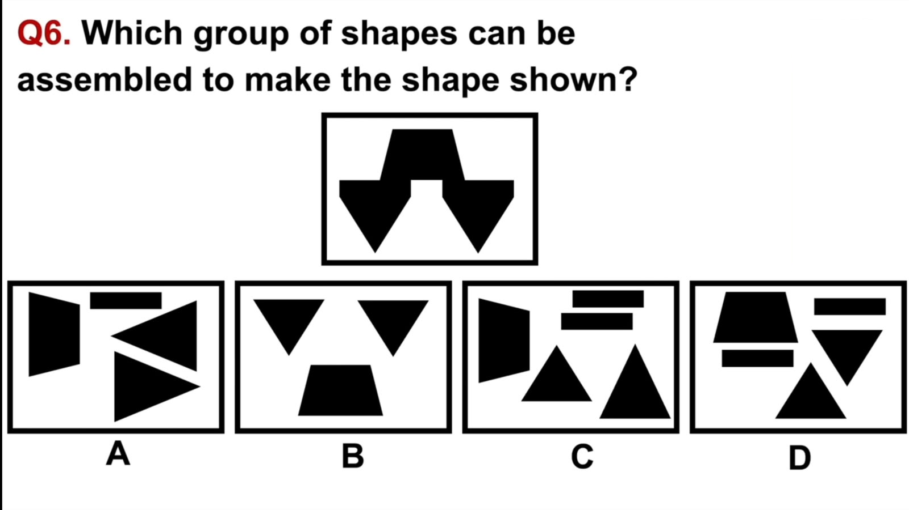

# Shape assembly II

> **Review needed** — Use for discussion; do not score this as a verified exercise.

## Question

Invite everyone to propose an answer and explain the rule. Compare approaches before the trainer closes the discussion.

Show answer and explanation

## Answer

Awaiting a verified answer key.

## Explanation

This image-only source provides no verified answer key. Record the class reasoning and use trainer review. This round is excluded from automatic accuracy.

## Source context

Gamified_Aptitude Final (1).pptx. Gamified_Aptitude Final (1).pptx; slide / round 7.
