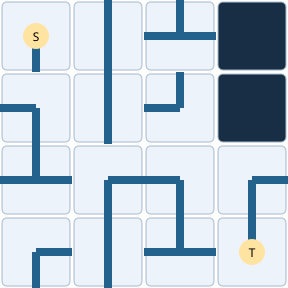

<!-- Generated from content/cognitive/rocket/cog-rocket-10-rocket-route-10.mdx. Edit the MDX source. -->

[Topic index](README.md)

**ID:** COG-rocket-10 · **Practice type:** Worked solution

# Rocket route 10

## Question

Rotate the path tiles clockwise to connect the rocket to its destination. Launch along the shortest possible route. The rocket and destination tiles are fixed; dark tiles are obstacles.

S and T are fixed. Dark cells are blocked. Turn other tiles clockwise in quarter turns; travel uses adjacent cells with connected openings.

Show answer and explanation

## Answer

6 travel moves.

## Explanation

The shortest route uses 6 moves: R1C1 → R2C1 → R2C2 → R2C3 → R3C3 → R3C4 → R4C4.
Connect both sides of every shared edge. A straight tile cannot turn; a corner tile must turn. Tile rotations do not count as travel moves. Other equally short routes are accepted.

---

[← COG-rocket-9](cog-rocket-9-rocket-route-09.md) · [Topic index](README.md) · [COG-rocket-11 →](cog-rocket-11-rocket-route-11.md)
