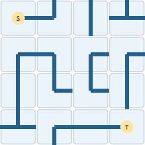

<!-- Generated from content/cognitive/rocket/cog-rocket-12-rocket-route-12.mdx. Edit the MDX source. -->

[Topic index](README.md)

**ID:** COG-rocket-12 · **Practice type:** Worked solution

# Rocket route 12

## Question

Rotate the path tiles clockwise to connect the rocket to its destination. Launch along the shortest possible route. The rocket and destination tiles are fixed; dark tiles are obstacles.

S and T are fixed. Dark cells are blocked. Turn other tiles clockwise in quarter turns; travel uses adjacent cells with connected openings.

Show answer and explanation

## Answer

8 travel moves.

## Explanation

The shortest route uses 8 moves: R1C1 → R1C2 → R2C2 → R2C3 → R3C3 → R3C2 → R4C2 → R4C3 → R4C4.
Connect both sides of every shared edge. A straight tile cannot turn; a corner tile must turn. Tile rotations do not count as travel moves. Other equally short routes are accepted.

## Source context

Cognitive Lab practice, round 12.

---

[← COG-rocket-11](cog-rocket-11-rocket-route-11.md) · [Topic index](README.md)
