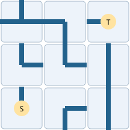

<!-- Generated from content/cognitive/rocket/cog-rocket-3-rocket-route-03.mdx. Edit the MDX source. -->

[Topic index](README.md)

**ID:** COG-rocket-3 · **Practice type:** Worked solution

# Rocket route 03

## Question

Rotate the path tiles clockwise to connect the rocket to its destination. Launch along the shortest possible route. The rocket and destination tiles are fixed; dark tiles are obstacles.

S and T are fixed. Dark cells are blocked. Turn other tiles clockwise in quarter turns; travel uses adjacent cells with connected openings.

Show answer and explanation

## Answer

4 travel moves.

## Explanation

The shortest route uses 4 moves: R3C1 → R2C1 → R2C2 → R1C2 → R1C3.
Connect both sides of every shared edge. A straight tile cannot turn; a corner tile must turn. Tile rotations do not count as travel moves. Other equally short routes are accepted.

## Source context

Cognitive Lab practice, round 3.

---

[← COG-rocket-2](cog-rocket-2-rocket-route-02.md) · [Topic index](README.md) · [COG-rocket-4 →](cog-rocket-4-rocket-route-04.md)
