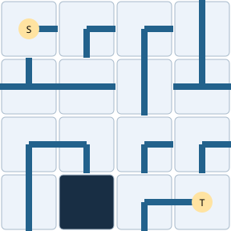

<!-- Generated from content/cognitive/rocket/cog-rocket-8-rocket-route-08.mdx. Edit the MDX source. -->

[Topic index](README.md)

**ID:** COG-rocket-8 · **Practice type:** Worked solution

# Rocket route 08

## Question

Rotate the path tiles clockwise to connect the rocket to its destination. Launch along the shortest possible route. The rocket and destination tiles are fixed; dark tiles are obstacles.

S and T are fixed. Dark cells are blocked. Turn other tiles clockwise in quarter turns; travel uses adjacent cells with connected openings.

Show answer and explanation

## Answer

6 travel moves.

## Explanation

The shortest route uses 6 moves: R1C1 → R1C2 → R2C2 → R3C2 → R3C3 → R4C3 → R4C4.
Connect both sides of every shared edge. A straight tile cannot turn; a corner tile must turn. Tile rotations do not count as travel moves. Other equally short routes are accepted.

## Source context

Cognitive Lab practice, round 8.

---

[← COG-rocket-7](cog-rocket-7-rocket-route-07.md) · [Topic index](README.md) · [COG-rocket-9 →](cog-rocket-9-rocket-route-09.md)
