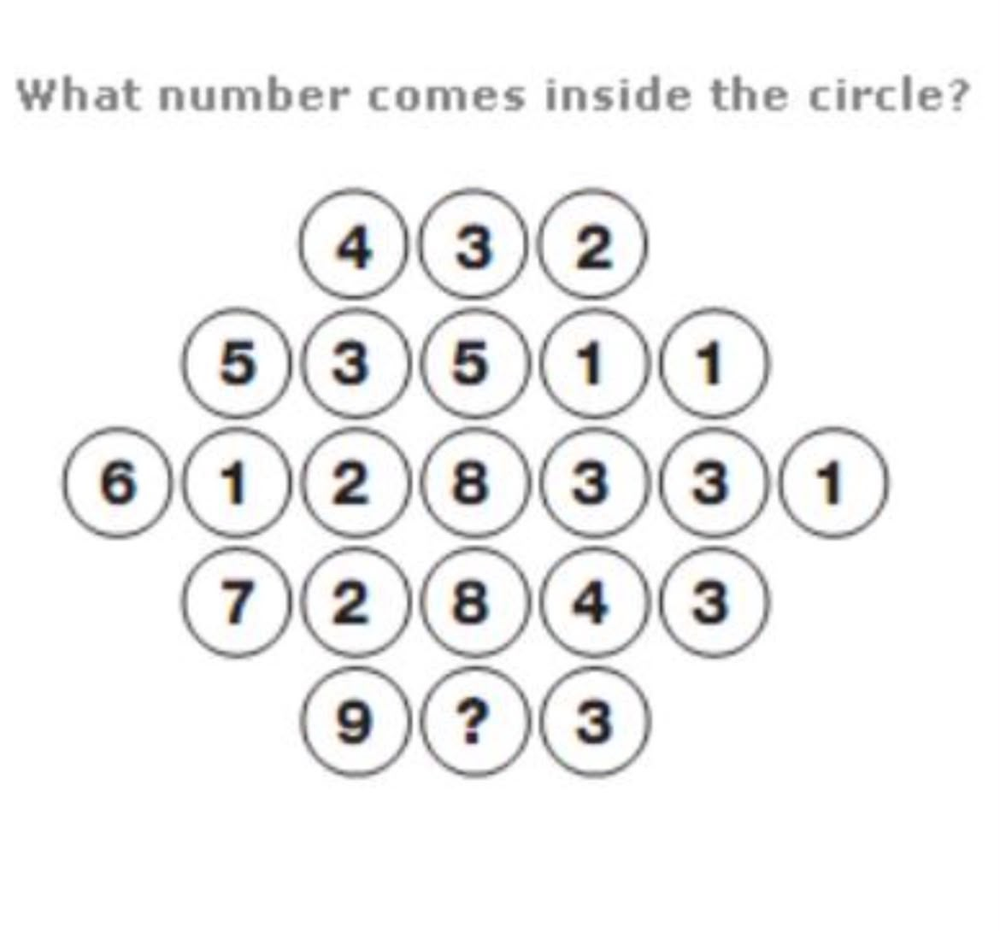

<!-- Generated from content/cognitive/visual/cog-visual-11-missing-number.mdx. Edit the MDX source. -->

[Topic index](README.md) · [Edit MDX](../../../content/cognitive/visual/cog-visual-11-missing-number.mdx)

**ID:** COG-visual-11 · **Status:** needs-review · **Updated:** 2026-11-15

# Missing number

> **Review needed** — Use for discussion; do not score this as a verified exercise.

## Question

Invite everyone to propose an answer and explain the rule. Compare approaches before the trainer closes the discussion.

Show answer and explanation

## Answer

Awaiting a verified answer key.

## Explanation

This image-only source provides no verified answer key. Record the class reasoning and use trainer review. This round is excluded from automatic accuracy.

## Source context

Gamified_Aptitude Final (1).pptx. Gamified_Aptitude Final (1).pptx; slide / round 21.

---

[← COG-visual-10](cog-visual-10-dot-matrix.md) · [Topic index](README.md)
