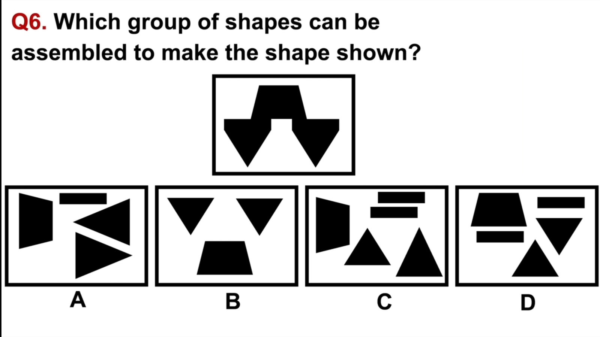

<!-- Generated from content/cognitive/visual/cog-visual-6-shape-assembly-ii.mdx. Edit the MDX source. -->

[Topic index](README.md)

**ID:** COG-visual-6 · **Practice type:** Reasoning practice

# Shape assembly II

> **Reasoning practice** · Write down the clues behind your answer before comparing possible rules.

## Question

Sketch a possible answer and explain your rule. Check whether the rule also fits the earlier shapes.

Show answer and explanation

## Answer

Use this as an open-ended reasoning exercise. Try to find a rule that fits every visible clue.

## Explanation

Write down a rule that fits the visible pattern. Check it against each shape, then look for a second rule that could also fit. This is an unscored exercise.

---

[← COG-visual-5](cog-visual-5-shape-assembly-i.md) · [Topic index](README.md) · [COG-visual-7 →](cog-visual-7-arrow-assembly.md)
