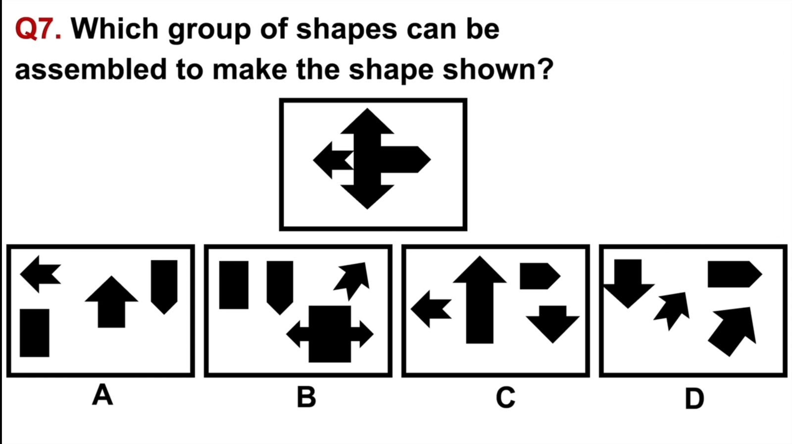

<!-- Generated from content/cognitive/visual/cog-visual-7-arrow-assembly.mdx. Edit the MDX source. -->

[Topic index](README.md) · [Edit MDX](../../../content/cognitive/visual/cog-visual-7-arrow-assembly.mdx)

**ID:** COG-visual-7 · **Status:** needs-review · **Updated:** 2026-11-15

# Arrow assembly

> **Review needed** — Use for discussion; do not score this as a verified exercise.

## Question

Invite everyone to propose an answer and explain the rule. Compare approaches before the trainer closes the discussion.

Show answer and explanation

## Answer

Awaiting a verified answer key.

## Explanation

This image-only source provides no verified answer key. Record the class reasoning and use trainer review. This round is excluded from automatic accuracy.

## Source context

Gamified_Aptitude Final (1).pptx. Gamified_Aptitude Final (1).pptx; slide / round 8.

---

[← COG-visual-6](cog-visual-6-shape-assembly-ii.md) · [Topic index](README.md) · [COG-visual-8 →](cog-visual-8-corner-word-discussion.md)
