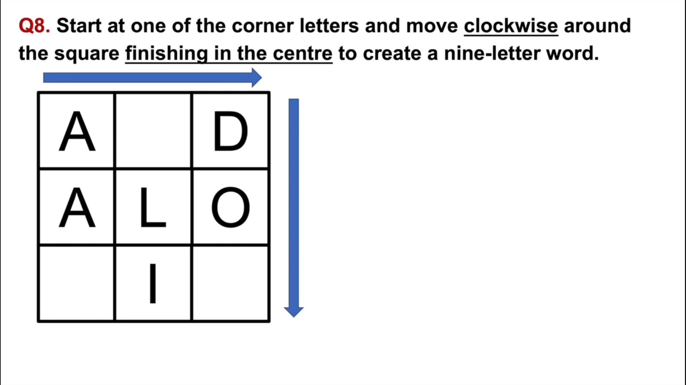

<!-- Generated from content/cognitive/visual/cog-visual-8-corner-word-discussion.mdx. Edit the MDX source. -->

[Topic index](README.md)

**ID:** COG-visual-8 · **Practice type:** Reasoning practice · **Difficulty:** Medium

# Corner word discussion

> **Reasoning practice** · Write down the clues behind your answer before comparing possible rules.

## Question

Sketch a possible answer and explain your rule. Check whether the rule also fits the earlier shapes.

Show answer and explanation

## Answer

Use this as an open-ended reasoning exercise. Try to find a rule that fits every visible clue.

## Explanation

Write down a rule that fits the visible pattern. Check it against each shape, then look for a second rule that could also fit. This is an unscored exercise.

---

[← COG-visual-7](cog-visual-7-arrow-assembly.md) · [Topic index](README.md) · [COG-visual-9 →](cog-visual-9-letter-and-number-logic.md)
